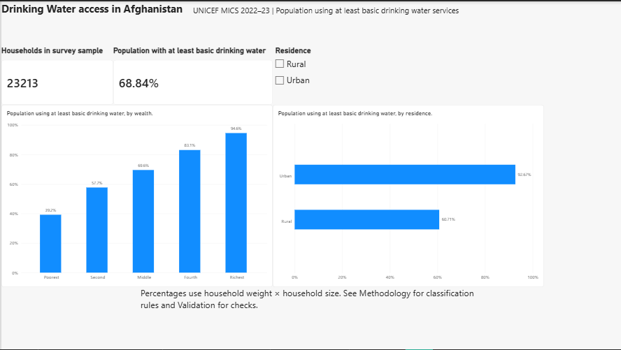

# Education Participation in Afghanistan

A Power BI portfolio project exploring education participation
by sex, residence, household wealth, and age using UNICEF
Afghanistan MICS 2022–23 data.

## Project question

How did attendance during school year 1401 differ among
children aged 7–17 at interview?

## Key findings

Weighted attendance among children with known attendance
status was **40.58%**.

| Comparison | Attendance |
|---|---:|
| Urban | 55.21% |
| Rural | 35.86% |
| Male | 50.75% |
| Female | 30.23% |
| Poorest household wealth group | 21.55% |
| Richest household wealth group | 62.66% |

The richest–poorest gap was **41.11 percentage points**.
Female attendance among children aged 16–17 was **10.68%**.

These are descriptive associations, not evidence of causality.

## Tools and skills

- Power Query: column selection, data types, joins and category labels
- Data modelling: household-to-child relationships
- DAX: sample counts and weighted attendance measures
- Power BI: interactive charts, slicers and validation
- Python: SPSS inspection and CSV conversion

## Data preparation

1. Retained completed household interviews.
2. Created a household key using cluster and household numbers.
3. Matched household members to completed households.
4. Selected children aged 7–17 at interview.
5. Applied questionnaire skip rules to attendance.
6. Retained unresolved responses separately.
7. Validated counts and report filtering.

## Methodology

The analysis includes **61,796 sampled children**:
- **61,763** with known attendance status
- **33** with unresolved attendance

Attendance includes school, formal Islamic education and
early childhood education covered by the questionnaire.

Children recorded as never having attended education, with
the attendance question skipped, were classified as not attending.

Weighted attendance was calculated as:

**Sum of household weights for attending children ÷
sum of household weights for children with known attendance.**

Survey weights were applied to percentages. Sample counts
are unweighted; weight sums are not national population totals.

## Project files

- [Dashboard screenshot](reports/education_overview.png)
- [Findings screenshot](reports/education_findings.png)
- [Report PDF](reports/Afghanistan_Education_Portfolio.pdf)
- [Detailed project summary](reports/PROJECT_SUMMARY.md)
- [Data dictionary](docs/data_dictionary.csv)
- [Python scripts](scripts/)
- [DAX measures and validation](docs/dax_measures.md)
- [Power Query preparation scripts](powerbi/)
- [Instructions to rebuild the analysis](docs/reproduce.md)

## Limitations

- Ages refer to age at interview.
- Results are not official school-level net attendance rates.
- Cross-sectional comparisons do not measure individual dropout.
- Unknown and no-response attendance answers are excluded
  from attendance percentages.
- Confidence intervals and statistical significance were
  not calculated.

## Data source and access

[UNICEF Afghanistan MICS 2022–23 report](https://www.unicef.org/afghanistan/reports/afghanistan-multiple-indicator-cluster-survey-mics-2022-2023)

[UNICEF survey catalogue](https://micsnada.unicef.org/index.php/catalog/310)

Source microdata and the PBIX containing imported records
are not included in this repository. Obtain microdata through
the official provider and follow its access and use conditions.

This is an independent learning project and is not affiliated
with or endorsed by UNICEF.

## Drinking Water Access Analysis

A second analysis examines how access to at least basic
drinking water varies by residence, household wealth
and province.

### Key results

| Group | Population using at least basic drinking water |
|---|---:|
| Overall | 68.84% |
| Urban | 92.67% |
| Rural | 60.71% |
| Poorest wealth group | 39.25% |
| Richest wealth group | 94.59% |

The urban–rural difference was 31.96 percentage points.
The richest–poorest difference was 55.34 percentage points.

### Method and validation

The analysis uses 23,213 completed household interviews.
Population percentages use household weight multiplied
by household size.

Classification adapts published Serbia MICS6 syntax to
Afghanistan's questionnaire codes. The national and
residence estimates match UNICEF's published Afghanistan
results when rounded to one decimal place.

An early weight-rounding error was identified, corrected
and documented before final reporting.

Confidence intervals and statistical significance were
not calculated.

### Files

- [Dashboard image](reports/drinking_water_overview.png)
- [Findings image](reports/drinking_water_findings.png)
- [Report PDF](reports/Afghanistan_Drinking_Water_Portfolio.pdf)
- [Project summary](reports/WASH_PROJECT_SUMMARY.md)
- [Cleaning log](docs/WASH_CLEANING_LOG.md)
- [DAX measures](docs/WASH_DAX_MEASURES.md)
- [Household Power Query code](powerbi/WASH_households.pq)
- [Province lookup code](powerbi/WASH_provinces.pq)
